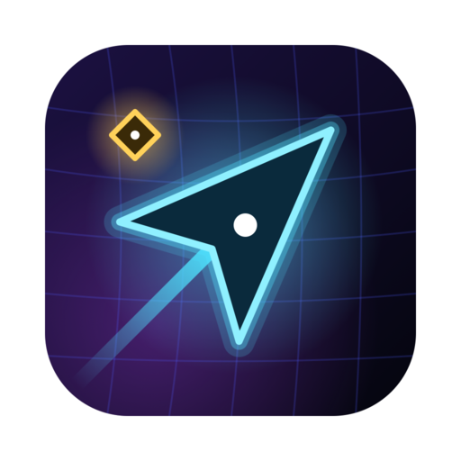
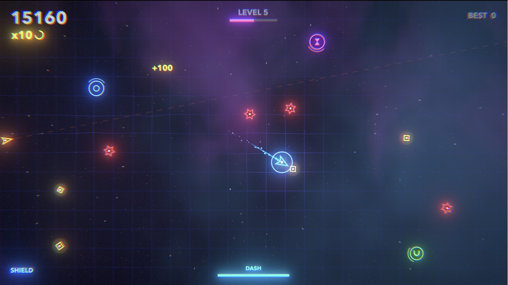

<p align="center">
  
</p>

<h1 align="center">Glowshift</h1>

<p align="center">
  A neon arena game. Collect sparks, dodge hunters, dash straight through them.
</p>

<p align="center">
  <a href="https://github.com/gabrimatic/glowshift/actions/workflows/ci.yml"></a>
  <a href="https://github.com/gabrimatic/glowshift/releases/latest"></a>
  <a href="LICENSE"></a>
  
</p>

<p align="center">
  
</p>

Glowshift is a fast arcade game for macOS, Windows, and Linux. Every frame is drawn by code: no sprites, textures, or audio files. The visuals come from shaders and the sound is synthesized when the game starts.

## Download

Get the latest build for your platform from [Releases](https://github.com/gabrimatic/glowshift/releases/latest).

| Platform | File | First launch |
| --- | --- | --- |
| macOS 11+ (Apple Silicon and Intel) | `Glowshift-<version>-macos.zip` | Unzip, move `Glowshift.app` to Applications, then open it once from **System Settings > Privacy & Security > Open Anyway** (the app is not notarized). |
| Windows 10+ (x64) | `Glowshift-<version>-windows.zip` | Unzip and run `Glowshift.exe`. If SmartScreen appears, choose **More info > Run anyway**. |
| Linux (x64) | `Glowshift-<version>-linux.zip` | Unzip, then `chmod +x Glowshift.x86_64` and run it. |

## How to play

Collect gold sparks to score. Hunters chase you; touching one ends the run unless you are dashing or shielded.

| Action | Keys |
| --- | --- |
| Move | `WASD` or arrow keys |
| Dash | `Space` (also `Shift` or `J`) |
| Pause | `Esc` or `P` |
| Quit from pause | `Q` |
| Fullscreen | `F` or `F11` |
| Start / restart | `Space`, `Enter`, or `R` |

### Scoring

- **Sparks**: 10 points times your combo.
- **Combo**: each spark you grab within 2.2 seconds of the last raises the multiplier, up to x10.
- **Dash kills**: dashing into a hunter destroys it, scores its value times your combo, and refills your dash, so kills can chain.
- **Levels**: a new level every 20 seconds. Hunters get faster and spawn more often.

Your best score is saved locally.

### Hunters

| Hunter | Appears | Behavior | Points |
| --- | --- | --- | --- |
| Chaser (red star) | Level 1 | Turns toward you and follows. | 25 |
| Dart (orange arrow) | Level 2 | Flashes a dashed line along its path, then launches in a straight line. | 40 |
| Splitter (purple hexagon) | Level 3 | Slow and large. Breaks into three fast minis when destroyed. | 60 |
| Mini (pink star) | From splitters | Small, fast chaser. | 15 |

### Power-ups

| Power-up | Effect |
| --- | --- |
| Shield (blue ring) | Absorbs one hit and destroys the hunter that touched you. |
| Slow time (purple hourglass) | Hunters move at 40% speed for 5 seconds. |
| Magnet (green U) | Pulls nearby sparks toward you for 7 seconds. |

## Run from source

Requirements: **Godot 4.7.2** (standard build, not .NET).

```bash
git clone https://github.com/gabrimatic/glowshift.git
cd glowshift
godot --path .
```

Open it in the editor instead: `godot --editor --path .`

On macOS you can install Godot with Homebrew: `brew install --cask godot`.

## Tests

The smoke test plays a scripted run through every hunter, power-up, and several level-ups without a window, then checks the run ended in a clean game over. It never touches your saved best score.

```bash
godot --headless --path . --import
godot --headless --fixed-fps 60 --path . -s res://tests/smoke_test.gd
```

It prints `SMOKE OK` and exits with code 0 on success. CI runs it on every push and pull request.

## Build

Install the Godot 4.7.2 export templates (**Editor > Manage Export Templates**), then:

```bash
mkdir -p build/macos build/windows build/linux
godot --headless --path . --export-release macOS build/macos/Glowshift.zip
godot --headless --path . --export-release Windows build/windows/Glowshift.exe
godot --headless --path . --export-release Linux build/linux/Glowshift.x86_64
```

Presets live in `export_presets.cfg`. The macOS build is a universal binary with an ad-hoc signature.

Releases are automatic: pushing a `v*` tag runs `.github/workflows/release.yml`, which tests, exports all three platforms, and publishes a GitHub release with notes from `CHANGELOG.md`.

## Project layout

```
main.gd                      game logic, drawing, HUD, and sound synthesis
main.tscn                    root scene
shaders/background.gdshader  nebula and parallax star field
shaders/post.gdshader        chromatic aberration, vignette, grain, and flash
icon.svg                     app icon
tests/smoke_test.gd          headless gameplay test
export_presets.cfg           macOS, Windows, and Linux export settings
```

Rendering uses the Forward+ renderer with 2D HDR. Colors with channels above 1.0 pass the glow threshold, which is how anything gets its neon bloom.

## Contributing

Bug reports, ideas, and pull requests are welcome. Start with [CONTRIBUTING.md](CONTRIBUTING.md); everyone taking part follows the [Code of Conduct](CODE_OF_CONDUCT.md).

## License

[MIT](LICENSE) © 2026 Soroush Yousefpour
