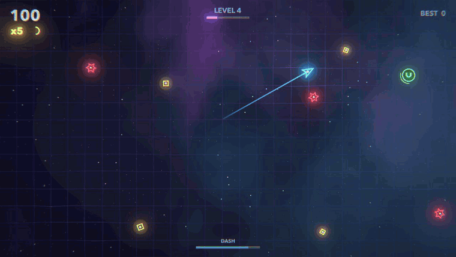

# Glowshift

[](https://github.com/gabrimatic/glowshift/actions/workflows/ci.yml)
[](https://github.com/gabrimatic/glowshift/releases/latest)
[](LICENSE)
[](https://gabrimatic.github.io/glowshift/)


**A neon arena game. Collect sparks, dodge hunters, dash straight through them.**

Glowshift is a short-session arcade game for keyboard or gamepad. Every run starts calm and turns into a swarm within a minute; the dash is both your escape and your weapon, and every kill you make with it hands the dash right back.

There are no game assets in this repository. Every shape is drawn by code, the bloom and nebula come from shaders, and the sound effects and music loop are synthesized when the game starts.

[Play in your browser](https://gabrimatic.github.io/glowshift/) · [Download](https://github.com/gabrimatic/glowshift/releases/latest) · [Changelog](CHANGELOG.md)

<p align="center">
  
</p>

## Play

| Where | How |
|-------|-----|
| **Browser** | Open [gabrimatic.github.io/glowshift](https://gabrimatic.github.io/glowshift/). Desktop Chrome, Edge, Firefox, or Safari. The browser build draws its glow by hand, so it looks a little softer than the desktop builds. |
| **macOS 11+** | Download `Glowshift-<version>-macos.zip`, unzip, and move `Glowshift.app` to Applications. The app is not notarized: open it once, then allow it in **System Settings > Privacy & Security > Open Anyway**. Universal binary for Apple Silicon and Intel. |
| **Windows 10+** | Download `Glowshift-<version>-windows.zip`, unzip, and run `Glowshift.exe`. If SmartScreen appears, choose **More info > Run anyway**. |
| **Linux (x64)** | Download `Glowshift-<version>-linux.zip`, unzip, `chmod +x Glowshift.x86_64`, and run it. |

## Controls

| Action | Keyboard | Gamepad |
|--------|----------|---------|
| Move | `WASD` or arrow keys | Left stick or D-pad |
| Dash | `Space`, `Shift`, or `J` | `A`, bumpers, or right trigger |
| Start / play again | `Space`, `Enter`, or `R` | `A` or `Start` |
| Pause / resume | `Esc` or `P` | `Start` |
| Quit (from pause) | `Q` | `Back` |
| Sound on/off | `M` | |
| Music on/off | `N` | |
| Reduced effects | `V` | |
| Fullscreen | `F` or `F11` | |

The game pauses on its own when its window loses focus. Settings and your best score are saved between sessions.

## How It Plays

- **Sparks** score 10 points times your combo.
- **Combo** rises by one for every spark you grab within 2.2 seconds of the last, up to **x10**. Lose the chain and it drops back to x1.
- **Dash kills** destroy a hunter, score its value times your combo, and refill your dash, so a good line chains through a whole group.
- **Close calls** score 5 points times your combo when a hunter brushes past without touching you.
- **Levels** arrive every 20 seconds. Hunters get faster and spawn more often.
- Arrows on the screen edge show where hunters are about to come in.

### Hunters

| Hunter | From | Behavior | Points |
|--------|------|----------|--------|
| Chaser (red star) | Level 1 | Turns toward you and follows. | 25 |
| Dart (orange arrow) | Level 2 | Flashes a dashed line along its path, then launches straight along it. | 40 |
| Splitter (purple hexagon) | Level 3 | Slow and large. Breaks into three fast minis when destroyed. | 60 |
| Mini (pink star) | Splitters | Small, fast chaser. | 15 |

### Power-ups

| Power-up | Effect |
|----------|--------|
| Shield (blue ring) | Absorbs one hit and destroys the hunter that touched you. |
| Slow time (purple hourglass) | Hunters move at 40% speed for 5 seconds. |
| Magnet (green U) | Pulls nearby sparks to you for 7 seconds. |

## Quick Start

Requirements: **Godot 4.7.2** (standard build, not .NET). On macOS: `brew install --cask godot`.

```bash
git clone https://github.com/gabrimatic/glowshift.git
cd glowshift
make run
```

| Command | What it does |
|---------|--------------|
| `make run` | Play from source |
| `make editor` | Open the project in the Godot editor |
| `make test` | Run the headless smoke test |
| `make export` | Build macOS, Windows, Linux, and web into `build/` (needs the 4.7.2 export templates) |
| `make serve` | Build the web version and serve it at `http://127.0.0.1:8060` |

Without `make`, run `godot --path .` to play.

## How It Works

1. `main.gd` runs the game: state, spawning, collisions, scoring, and every draw call, through Godot's `_draw()` API.
2. Colors with channels above 1.0 pass the HDR glow threshold, so the ship, hunters, and sparks bloom while the HUD text stays crisp.
3. A 48-pixel spring grid takes an impulse from every explosion, dash, and pickup, then settles back.
4. `shaders/background.gdshader` paints the drifting nebula and two parallax star layers; `shaders/post.gdshader` adds chromatic aberration, vignette, grain, and the death flash.
5. `scripts/synth.gd` builds nine sound effects and a four-bar synthwave loop from sine, square, triangle, and noise at startup. The music loop builds a slice at a time across the first frames, so the title screen never stalls (browsers run the game without threads).
6. `scripts/settings.gd` keeps sound, music, effects, and the best score in a small config file.

The browser build uses Godot's Compatibility renderer, which has no 2D bloom. The game detects it and draws extra halo strokes instead.

## Tests

```bash
make test
```

The smoke test plays a scripted run without a window: it reaches level 4 and beyond, spawns every hunter, collects power-ups, destroys splitters, builds a full combo, waits for the music loop, then dies and checks the game over state. It prints `SMOKE OK` and exits with code 0, and it never touches your saved settings or best score. CI runs it on every push and pull request.

## Releases

Pushing a `vX.Y.Z` tag runs `.github/workflows/release.yml`. It re-runs CI, checks that the tag matches `config/version` and `CHANGELOG.md`, exports all four platforms, publishes a GitHub release with notes from the changelog, and deploys the web build to GitHub Pages.

## Project Layout

```text
main.gd                       game state, gameplay, drawing, and HUD
main.tscn                     root scene
scripts/synth.gd              sound effects and music, synthesized at startup
scripts/settings.gd           saved settings and best score
shaders/background.gdshader   nebula and parallax stars
shaders/post.gdshader         aberration, vignette, grain, flash
tests/smoke_test.gd           headless gameplay test
export_presets.cfg            macOS, Windows, Linux, and web export settings
icon.svg                      app icon
assets/                       README images (not shipped in the game)
```

## Contributing

Bug reports, balance notes, and pull requests are welcome. Start with [CONTRIBUTING.md](CONTRIBUTING.md). Everyone taking part follows the [Code of Conduct](CODE_OF_CONDUCT.md). Security reports go through [SECURITY.md](SECURITY.md).

## License

MIT. See [LICENSE](LICENSE).

---

Created by [Soroush Yousefpour](https://gabrimatic.info)

[](https://www.buymeacoffee.com/gabrimatic)
